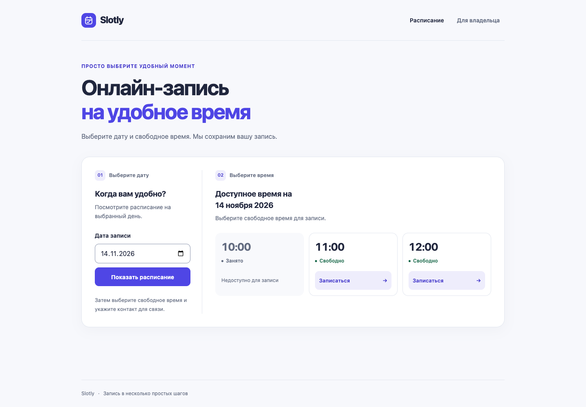
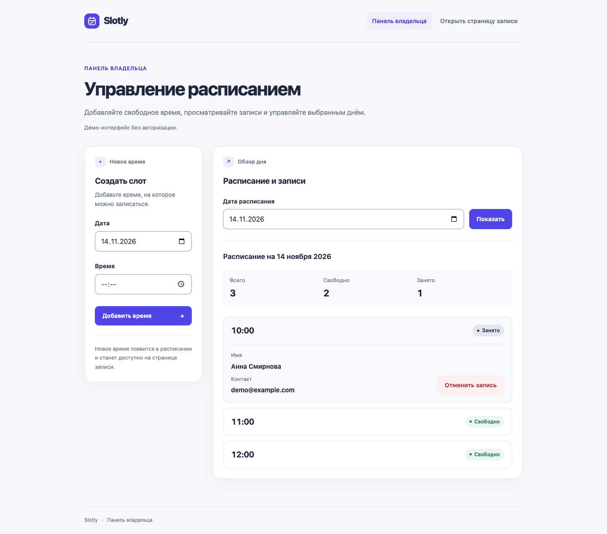

# Slotly

Slotly — учебный веб-сервис онлайн-записи на свободное время для малого бизнеса.
Владелец создаёт расписание, клиент выбирает дату и время, оставляет имя и контакт
и получает страницу подтверждения. Отмена записи освобождает это время.

**Учебная и локальная версия.** Её можно запускать на своём компьютере и в учебном
Docker-контейнере. Не публикуйте сервис в интернете с реальными контактными
данными, пока не появятся авторизация владельца и защита страниц записи.
`/admin` открыт, а подтверждение и отмена доступны по числовому идентификатору.

## Возможности

- Создание слотов в панели владельца `/admin`.
- Публичное расписание на выбранную дату, сортировка по времени.
- Статусы для клиента: «Свободно», «Занято», «Время прошло».
- Бронирование свободного будущего слота: имя, контакт и `created_at`.
- Подтверждение и отмена через отдельные страницы. Отмена выполняется только POST.
- После отмены слот снова можно занять, если его время ещё не прошло.
- Одинаковые дата и минута не создаются повторно. Секунды нового слота отбрасываются.
- Двойное бронирование одного слота блокируется транзакцией `BEGIN IMMEDIATE`
  и ограничением `UNIQUE(bookings.slot_id)`. Конфликт отвечает HTTP 409.
- В панели владельца видны имя и контакт. В публичном расписании они скрыты.
- Интерфейс работает без JavaScript.

## Технологии

Проверено на Python 3.11.9:

- FastAPI 0.142.2
- Uvicorn 0.54.0 (`uvicorn[standard]`)
- SQLAlchemy 2.1.1
- Pydantic 2.13.5
- Jinja2 3.1.6
- python-multipart 0.0.32
- SQLite
- HTML5 и CSS3

Тесты: pytest 9.1.1 и httpx 0.28.1. Они стоят в `requirements-dev.txt` и не
устанавливаются в Docker-образ.

Часовой пояс приложения по умолчанию — `Europe/Moscow` (`APP_TIMEZONE`).

## Структура проекта

```text
.
├── app/
│   ├── main.py                 # приложение, startup, health и описание OpenAPI
│   ├── timezone.py             # APP_TIMEZONE и текущее время приложения
│   ├── calendar_view.py        # сетка календаря
│   ├── static_assets.py        # версия CSS по содержимому файла
│   ├── database/
│   │   ├── database.py         # SQLite, WAL, busy_timeout, BEGIN IMMEDIATE
│   │   └── models.py           # Slot и Booking
│   ├── schemas/
│   ├── services/
│   ├── routers/
│   │   ├── admin.py
│   │   └── public.py
│   ├── static/
│   └── templates/
├── docker/entrypoint.py        # права на /app/data и сброс root
├── data/                       # локальная SQLite; файл базы не хранится в Git
├── docs/
├── tests/
├── Dockerfile
├── .dockerignore
├── requirements.txt            # зависимости запуска
└── requirements-dev.txt        # зависимости тестов
```

## Локальный запуск на macOS

Нужны Python 3.11 и `pip`. Готовая база и `.env` не требуются.

```bash
git clone https://github.com/vahrus/slot-booking.git
cd slot-booking
python3 -m venv .venv
source .venv/bin/activate
python -m pip install -r requirements.txt
python -m pip install -r requirements-dev.txt
python -m uvicorn app.main:app --host 127.0.0.1 --port 8000
```

Локальный сервер слушает только `127.0.0.1`. Файл `data/booking.db` создаётся
при старте. Первое открытие включает журнал WAL; рядом могут появиться
`booking.db-wal` и `booking.db-shm`. Эти файлы исключены из Git. Остановка
сервера сохраняет записи.

Проверка:

- http://127.0.0.1:8000/ — расписание
- http://127.0.0.1:8000/admin — панель владельца
- http://127.0.0.1:8000/health — `{"status":"ok","app":"Slotly"}`

Часовой пояс можно переопределить на время процесса:

```bash
APP_TIMEZONE=Asia/Dubai python -m uvicorn app.main:app --host 127.0.0.1 --port 8000
```

`.env` приложение само не читает. Пример имени переменной лежит в `.env.example`.

## Тесты

Из корня проекта, в активированном окружении:

```bash
python -m pytest -q
```

Тесты используют временные файлы SQLite и не открывают `data/booking.db`.

Фактический прогон 9 ноября 2026, Python 3.11.9, окружение с версиями из
`requirements.txt` и `requirements-dev.txt`:

```text
169 passed in 2.64s
```

Упавших тестов нет. В этот прогон входят прежние проверки базы, слотов,
бронирования, отмены, интерфейса, календаря и часового пояса, а также
конкурентное бронирование, `database is locked` → HTTP 409, обрезка времени
до минут и `AUTOINCREMENT` для новых баз.

## Маршруты

Сервис отдаёт HTML. Успешное изменение данных идёт по схеме POST → 303 → GET.

| Метод | Путь | Назначение |
| --- | --- | --- |
| GET | `/` | Расписание. Неверная дата остаётся на странице с текстом ошибки. |
| GET | `/health` | Проверка, что процесс отвечает. Базу не открывает. |
| GET | `/admin` | Панель владельца без входа. |
| POST | `/admin/slots` | Создать слот. Успех и дубликат — редирект 303, неверная форма — 400. |
| GET | `/booking/{slot_id}` | Форма записи. Нет слота — 404, занят или прошёл — 409. |
| POST | `/booking/{slot_id}` | Создать запись. Успех — 303, ошибка полей — 400, конфликт — 409. |
| GET | `/booking/{booking_id}/success` | Подтверждение сохранённой записи. |
| GET | `/booking/{booking_id}/cancel` | Страница подтверждения отмены, данные не меняет. |
| POST | `/booking/{booking_id}/cancel` | Отменить запись и перейти к расписанию. |

`/docs`, `/redoc` и `/openapi.json` строятся FastAPI автоматически. Схема
перечисляет эти HTML-пути и поля форм. Коды 303, 400, 404 и 409 в неё не
вынесены: их возвращает код страниц, а не отдельные JSON-модели. Отдельного
JSON API бронирований нет.

## Docker

Образ основан на `python:3.11-slim`, ставит `tzdata` и по умолчанию использует
`APP_TIMEZONE=Europe/Moscow`. Внутри слушает `0.0.0.0:8000` один процесс Uvicorn.
Заголовки прокси по умолчанию не принимаются. Секретов и файла `data/booking.db`
в контексте сборки нет: каталог `data/` исключён `.dockerignore`.

Контейнер кратко стартует от root, чтобы отдать каталог `/app/data` пользователю
`slotly` (uid 1000). Права файлов не ослабляются, `chmod 777` не используется.
Дальше Uvicorn работает уже как `slotly`.

Учебный volume отдельный от локальной базы проекта. Не монтируйте
`./data/booking.db` в этот контейнер.

```bash
docker build -t slotly:homework .
docker volume create slotly-homework-data
docker run -d --name slotly-homework \
  -p 127.0.0.1:8000:8000 \
  -e APP_TIMEZONE=Europe/Moscow \
  -v slotly-homework-data:/app/data \
  slotly:homework
```

SQLite окажется в `/app/data/booking.db` внутри volume, вместе с файлами WAL.
Для этой базы нужен один контейнер: второй процесс на тот же файл не запускайте.

Проверка:

```bash
curl -fsS http://127.0.0.1:8000/health
curl -fsS -o /dev/null -w "%{http_code}\n" http://127.0.0.1:8000/
docker logs slotly-homework
```

Ожидаемый health-check: `{"status":"ok","app":"Slotly"}`. Главная страница — HTTP 200.

Сохранение данных проверяется новым контейнером на том же volume:

```bash
docker rm -f slotly-homework
docker run -d --name slotly-homework \
  -p 127.0.0.1:8000:8000 \
  -v slotly-homework-data:/app/data \
  slotly:homework
```

Остановка учебного контейнера не удаляет образ и volume:

```bash
docker rm -f slotly-homework
```

Образ в Docker Hub этим проектом не публикуется.

9 ноября 2026 образ `slotly:homework` был собран из этого проекта. Контейнер
`slotly-homework` на volume `slotly-homework-data` ответил на `/health` и `/`,
создал слот, принял запись, отменил её и после нового контейнера на том же
volume снова показал сохранённую запись. Локальный `data/booking.db` к контейнеру
не подключался. После проверки контейнер удалён, образ и учебный volume оставлены.

## Использование

### Создание расписания

Откройте `/admin`, укажите дату и время и нажмите «Добавить время». Повтор той
же минуты показывает понятную ошибку. В сводке владельца прошедший свободный
слот остаётся в статусе `free`.

### Бронирование

В публичном расписании выберите дату и свободное будущее время. Имя и контакт
обязательны, крайние пробелы убираются, максимум — 100 символов. После
подтверждения слот становится «Занято». Сохраните адрес страницы подтверждения,
если понадобится отмена.

### Отмена

На странице подтверждения откройте «Отменить запись» и подтвердите POST.
Просмотр страницы отмены запись не удаляет. После отмены владелец возвращается
в `/admin` выбранного дня, клиент — в публичное расписание.

### Короткая демонстрация

1. В `/admin` создайте на одну будущую дату слоты 10:00, 11:00 и 12:00.
2. В публичном расписании откройте запись на 10:00.
3. Введите вымышленные данные: `Анна Смирнова`, `demo@example.com`.
4. Подтвердите запись и сохраните адрес страницы подтверждения.
5. Проверьте «Занято» в расписании и данные клиента в `/admin`.
6. Повторная запись на тот же слот отвечает, что время уже занято.
7. На форме отмены выберите «Оставить запись» и убедитесь, что состояние не изменилось.
8. Подтвердите отмену. Если время ещё не прошло, слот снова можно занять.

## Защита от двойного бронирования

Запись и смена статуса `free` → `booked` выполняются в одной транзакции
`BEGIN IMMEDIATE`: блокировка берётся до повторного чтения слота. Вторую запись
дополнительно запрещает `UNIQUE(bookings.slot_id)`. При конфликте или блокировке
`database is locked` изменения откатываются, клиент получает HTTP 409.
Одинаковая минута защищена `UNIQUE(slots.date, slots.time)`.
Подробнее — в [технической спецификации](docs/TECH_SPEC.md).

Для SQLite рассчитан один процесс. Несколько workers Uvicorn или два контейнера
на одном файле базы не используются.

## Ограничения безопасности

- Это учебный локальный сервис. Не выставляйте его в интернет с реальными
  телефонами, email и именами без отдельной защиты.
- `/admin` не требует пароля и показывает имя и контакт записи.
- Страницы подтверждения и отмены открываются по числовому `booking.id`.
  Владелец записи не проверяется.
- CSRF-токенов и пользовательских сессий нет.
- В уже существующей `data/booking.db` идентификаторы не переведены на
  `AUTOINCREMENT`. Новые базы создаются с ним. Автоматическая миграция не
  выполняется.
- Дата и время слота хранятся без собственного часового пояса и читаются
  в `APP_TIMEZONE`.
- `GET /health` не проверяет доступность файла SQLite.

## Интерфейс

Снимки используют вымышленные данные.

| Публичное расписание | Панель владельца с записью |
| --- | --- |
|  |  |

Другие состояния: [форма записи](docs/screenshots/02-booking-form.png),
[подтверждение](docs/screenshots/03-booking-success.png),
[свободное расписание владельца](docs/screenshots/04-admin-schedule.png),
[отмена на мобильном экране](docs/screenshots/06-cancellation.png).

## Результаты аудита и тестирования

Аудит нашёл открытую панель `/admin`, доступ к записи по числовому id, гонку
чтения слота до записи и ответ 500 при `database is locked`. Для новых баз
SQLite мог повторно выдать удалённый id. Секунды в новом слоте отображались
как та же минута, что и уже существующий слот.

Исправлено без смены публичных URL и без миграции рабочей базы:

- запись и отмена берутся в `BEGIN IMMEDIATE`, на соединении включены WAL,
  `busy_timeout` и `foreign_keys`;
- блокировка SQLite при бронировании откатывается и возвращает HTTP 409;
- секунды и микросекунды нового слота обнуляются;
- новые базы создаются с `AUTOINCREMENT`; существующий `data/booking.db` не
  перестраивается;
- обработчики с SQLAlchemy выполняются как обычные функции;
- образ ставит `tzdata`, слушает `0.0.0.0:8000` одним процессом и запускает
  Uvicorn от пользователя `slotly`. Заголовки прокси по умолчанию не принимаются.

Фактические результаты 9 ноября 2026, Python 3.11.9:

- pytest: **169 passed, 0 failed**, 2.64 с;
- образ `slotly:homework` собран;
- контейнер ответил на `/health` и прошёл создание слота, запись и отмену;
- тот же named volume сохранил SQLite в новом контейнере;
- `data/booking.db` не изменился: SHA-1
  `91a076b63a7f4da89f6e159cd964bbc0180ea6a5`.

Авторизация `/admin` и секрет отмены записи сознательно не добавлялись.
Сервис остаётся учебным и локальным.

## Техническая документация

- [Техническая спецификация](docs/TECH_SPEC.md)
- [Проверка готовности к сдаче](docs/SUBMISSION_CHECKLIST.md)
